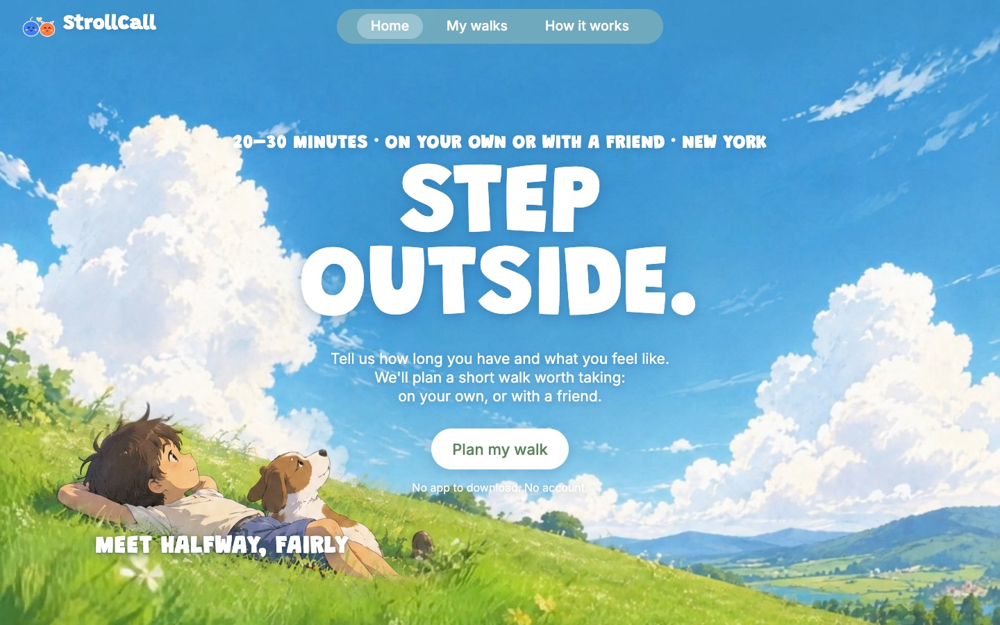
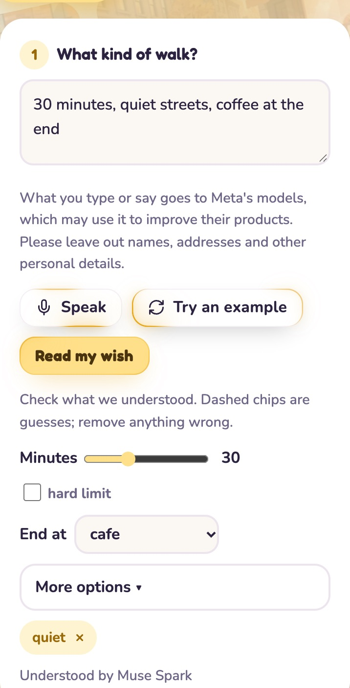
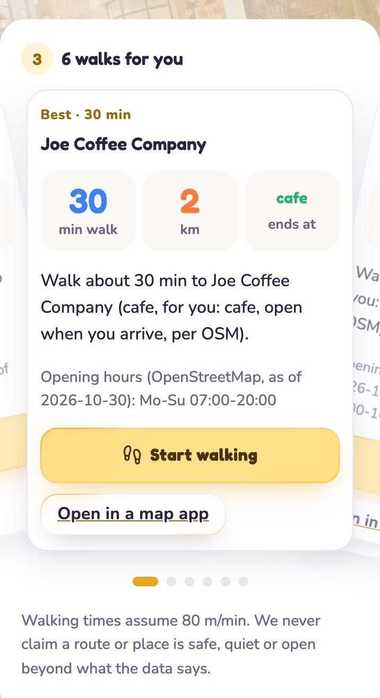
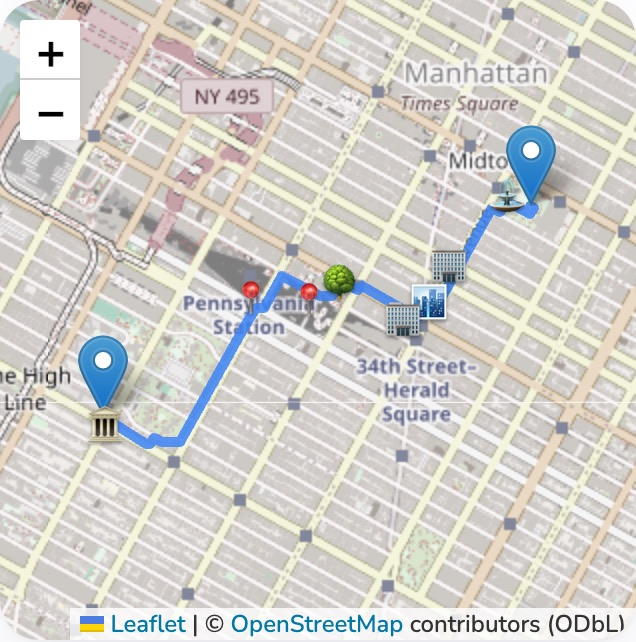
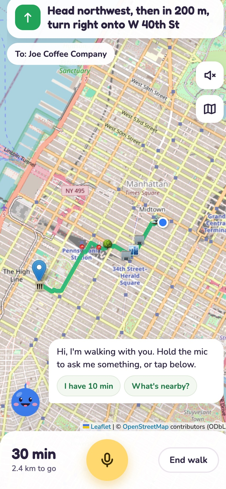
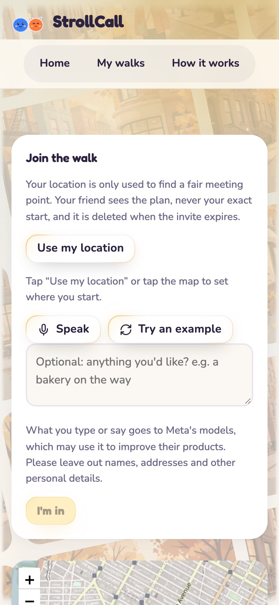
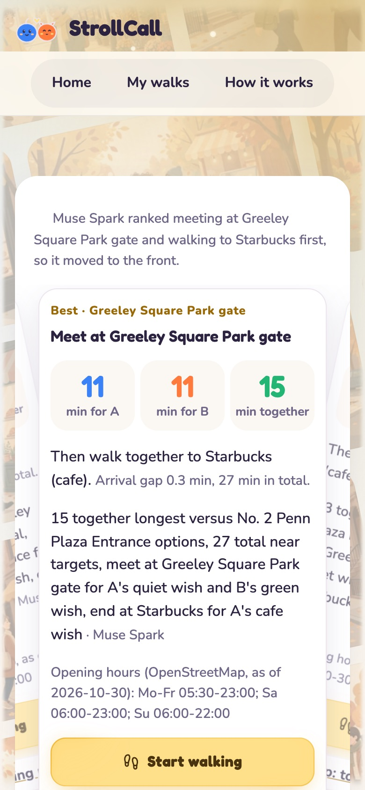
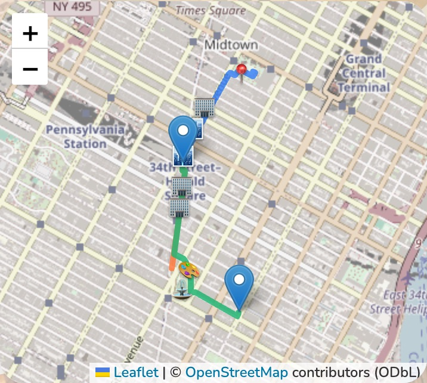

# StrollCall

*Less planning. More walking.*

**Live: https://strollcall.onrender.com** · works in any phone or desktop browser · no app, no account

<p align="center">
  
</p>

StrollCall is about getting outside. You say how long you have and what you feel like ("25 minutes,
quiet streets, coffee at the end"), and it plans a short walk worth taking in New York: a route past
places nearby, ending somewhere good, with turn-by-turn directions in the browser.

Walking on your own is the default. If you want company, invite a friend with one link: StrollCall
finds a meeting point that is fair in **walking time** for both of you, then a shared walk to a
destination you both like.

Meta models read what you ask for (and, with a friend, reconcile both people's wishes); a
deterministic planner on our own walking map checks that every plan is real and feasible. Models never
invent a route, a time or a place: every number on screen is measured on the map.

Built for the Meta Global AI Developer Hackathon (Oct 28 – Nov 4, 2026). All code in this
repository was written during the event; no code from earlier projects was reused.

## Contents

- [A walk in pictures](#a-walk-in-pictures)
- [Features](#features)
- [How it works](#how-it-works)
- [How Meta models are used](#how-meta-models-are-used)
- [Open-weights model](#open-weights-model)
- [Privacy](#privacy)
- [Repository layout](#repository-layout)
- [Setup](#setup)
- [Data and attribution](#data-and-attribution)

## A walk in pictures

Screenshots of the running app (phone width, 2026-11-03). The start points are public places in Midtown
Manhattan: Bryant Park (you) and Madison Square Park (your friend).

**On your own.** Type or say a wish (or press *Try an example*), check what was understood, pick a start
point, and choose from up to six walks. The map shows the route and the places it passes.

<table>
  <tr>
    <td align="center" width="33%"><br><sub>1. The wish, as understood by Muse Spark. Dashed chips would be guesses you can remove.</sub></td>
    <td align="center" width="33%"><br><sub>2. Up to six walks to swipe through, each with minutes, distance and why it fits.</sub></td>
    <td align="center" width="33%"><br><sub>3. The route and the places it passes (⛲ fountain, 🏢 notable building, 🌳 park, 🏛️ historic site…).</sub></td>
  </tr>
</table>

**Walking.** *Start walking* turns the page into a walking screen: the next turn, minutes and distance
left, cards for places you pass, and the walking buddy in the corner.

<p align="center">
  
</p>

**With a friend.** Send one link. Your friend adds a start point and, if they like, a wish of their own.
StrollCall finds meeting points that are fair in walking time, a shared walk on to a place you both like,
and Muse Spark explains the choice.

<table>
  <tr>
    <td align="center" width="33%"><br><sub>1. Your friend joins: a start point and an optional wish.</sub></td>
    <td align="center" width="33%"><br><sub>2. The plan: 11 minutes each to Greeley Square, 15 together, and why.</sub></td>
    <td align="center" width="33%"><br><sub>3. You (blue) and your friend (orange, short here) meet, then walk on together (green).</sub></td>
  </tr>
</table>

## Features

**Plan a walk from a sentence.** Minutes, an end point (cafe, park, back where you started…), a mood, and
places to pass or avoid, typed or spoken (Muse Voice Transcribe). What was understood shows as chips you
can edit; guesses are dashed and never become hard rules. *Try an example* fills in a wish for anyone
without an idea yet. *More options* adds route shape, pace, places to pass by or avoid, stops on the way,
and a free-text *Something else*.

**Only real, feasible plans.** The planner searches our own OpenStreetMap walking graph and place snapshot
for routes that fit the time, ranks them by the wish, and shows the reason for each. Opening hours are shown
as OpenStreetMap lists them ("as of" the snapshot date); a place is called open only when the data says so.

**Walking guidance in the browser.** "Start walking" follows the route (Geolocation API, screen Wake Lock):
live position, remaining time, the next turn ("In 150 m: Turn left onto E 20th St", from street names along
the graph path), a new route from where you are after 15 s more than 50 m off it, an arrival card within
40 m, and cards for parks, historic sites, artworks, memorials and landmarks within ~40 m of the route,
with short intros from Wikipedia. The track stays in the phone; only a re-plan sends the current position,
which the server neither stores nor logs. The map-app link stays as a fallback.

**The walking buddy.** The blue character on the walking screen (`frontend/js/buddy.js`,
`backend/app/services/companion.py`). Hold the mic or tap a chip ("I have 10 min", "What's nearby?").
For spoken requests Muse Spark picks one tool from the words and the minutes left only: `add_stop`,
`set_time_left`, `whats_nearby`, `identify_landmark`, `reroute_avoid`; chips run the tool directly. Tools run
on our own map data, route changes go through the planner's walking graph and can be undone, and every reply
is built from the tool's result. With Voice on, the buddy speaks with an ElevenLabs voice (the phone's own
voice if that fails). `COMPANION_ENABLED=false` hides it everywhere; `?buddy=off` (or `=on`) on a page
switches it for one phone.

**Walk with a friend, fairly.** One link, no accounts. The planner compares meeting points by walking time
for both people (not by distance on the map), keeps the arrival gap small, and then plans a shared walk to a
destination that fits both wishes. Muse Spark reconciles the two wishes, ranks the fair options and writes
the invite line; each person sees the plan, never the other's start point.

**Meet halfway, fairly (Home).** A section under the headline compares two small maps from one real
benchmark pair: walking to the point halfway between the two starts on the map, and walking to our
planner's meeting point. The numbers and routes are measured once on the local walking graph by
`scripts/build_fairness_example.py` and saved to `frontend/data/fairness_example.json`; the page reads
only that file (no planning at load) and hides the section without it. The current example is pair
**p2** (Christopher Street-Stonewall station and 14th Street-Union Square station), generated
2026-11-01: 6 and 11 minutes to the map midpoint, 10 and 9 minutes to our meeting point.

**My walks and recaps.** Finished walks are kept on the phone (My walks); a recap can be shared as a link
without any start point.

## How it works

```
 wish (text or voice) ──► Muse Spark / Muse Glimmer ──► WalkIntent (validated JSON)
                                                              │
 start point (stays on the server, never sent to a model) ──► planner on our own walking graph
                                                              │   (OpenStreetMap, 80 m/min)
                                                              ▼
                                   candidate walks (measured minutes, places, opening hours)
                                                              │
                         Muse Spark ranks / explains, checked against the measured facts
                                                              ▼
                     page: plan deck + map ──► walking screen + buddy (tools on the same graph)
```

- **Backend:** Python 3.11, FastAPI, NumPy/SciPy for the walking graph, Neon Postgres (SQLite locally).
- **Frontend:** plain HTML, CSS and JavaScript with Leaflet; no build step.
- **Models:** Meta Model API (Muse Spark, Muse Voice Transcribe, Muse Image), Muse Glimmer (open weights) on
  our own Modal endpoint, and ElevenLabs for the buddy's voice.
- **Hosting:** Render (web service), Neon (database), Modal (GPU endpoint, only during set windows).
- **Checks:** every model answer must fit a JSON schema and the app's own validation; numbers and place
  features must come from our data, else rule-based text is used and the page says so. Every Meta call
  goes through a spend guard with a daily cap.

## How Meta models are used

Solo walks use Muse Spark to read the wish (minutes, end point, mood, and the place features it asks
for, which decide the order of the options the planner scores) and for place intros. Friend walks add
two-person negotiation, the ranking of the fair meetup options with reasons, and the invite line.

| Job | Used in | Model | Output | Deterministic check |
| --- | --- | --- | --- | --- |
| Parse a walk description | both | Muse Glimmer (open weights, our Modal endpoint) when warm, else Muse Spark (`muse-spark-1.3`) | `WalkIntent` | JSON schema + Pydantic; Muse Spark after 3 s or on any error; default on failure |
| Read wishes as place features ("sit outside", "not a chain") | both | Muse Spark | requirements from a fixed menu, with the quote | menu-limited; the planner scores them on OpenStreetMap data |
| Read "Something else" under More options (Pass by, Avoid, Stops on the way) | both | Muse Spark | kinds from a fixed list per field, named places, number of stops, what it can't map | words only, no position; named places are looked up in our own map data, else not used; keyword rules without the model; "hills", "lighting" and the like are reported as not supported |
| Reconcile both people's preferences | with a friend | Muse Spark | `JointPreference` + trade-off | shared vibes must come from both people; never changes time or hard constraints |
| Rank the fair meetup plan's top 6 | with a friend | Muse Spark | order + reasons | only the supplied candidates; every number must be a measured fact |
| Invite line | with a friend | Muse Spark | one or two sentences | no place, safety, crowd or weather claims |
| Speech to text | both | Muse Voice Transcribe | transcript | WAV format check; user edits before parsing |
| The walking buddy's voice (not Meta) | both | ElevenLabs text to speech (`eleven_flash_v2_5`, voice Jessica) | MP3 | only the line, never a position; 6 s timeout, cache, daily character cap (`ELEVENLABS_DAILY_CHAR_CAP`); the phone's own voice on any failure or without `ELEVENLABS_API_KEY` |
| Illustrations | both | Muse Image (24 pictures made ahead of time, picked by theme) | image | model and prompt per file in `frontend/illustrations/manifest.json` |
| Intros of places passed on a walk | both | Muse Spark (ahead of time, `scripts/make_poi_intros.py`) | at most 2 sentences | only from the place's Wikipedia summary; every number, name, feature and evaluative word must be in that text, else dropped |

Every Meta call goes through a spend guard with a daily cap (`DAILY_BUDGET_USD`); past the cap the
app switches to clearly labelled mock data. API responses say whether data is `meta`, `mock` or
`default`.

## Open-weights model

Wish reading runs on **Muse Glimmer**, Meta's open-weights model (`meta-models/Muse-Glimmer-30B`, BF16,
pinned revision `f84ecc3`), on our own **Modal** Dedicated Endpoint (SGLang, 1x H200,
`ep-ez0BAxZPNiSL3x40VCpbFi`) whenever it is warm, with reasoning off (the prompt opens the model's answer
channel) and the answer constrained to the `WalkIntent` JSON schema. If it doesn't answer within 3 s, or
outside a warm window, Muse Spark reads the wish. The page says which model read it ("Read by Muse Glimmer (open
weights, on Modal)"), plans record it, `/health` shows the deployment, and every Glimmer call writes a
run-log line (model, precision, host, GPU, endpoint, latency; no user text).

The endpoint scales to zero after 2 idle minutes. `scripts/glimmer_warm.py` warms it for a set window
and stops before Modal's bill passes $20. Pre-registered evaluation against `muse-spark-1.3`:
`scripts/eval_open_weights.py`, results in `benchmarks/2026-10-31-open-weights-run1.md`, and raw outputs side by
side in `sample_outputs/open_weights/`. In run 1 Glimmer read wishes in 0.55 s (median) against 3.58 s for
Muse Spark, with 10 of 12 valid against 12 of 12. Deployment, budget and commands: `docs/open_weights.md`.

## Privacy

- Your start point is used to plan and is never sent to any model; Meta receives only your words, place
  names and features, and walking minutes (a test checks every request for coordinates).
- With a friend, each person sees the plan, never the other's exact start; start points are deleted when
  the invite expires.
- During a walk the track stays on the phone; only a re-plan sends the current position, which the server
  neither stores nor logs.
- The buddy's voice: only the line being spoken is sent to ElevenLabs.
- Full details on the app's Privacy page (`frontend/privacy.html`).

## Repository layout

| Path | What is there |
| --- | --- |
| `backend/app/api/` | FastAPI routes: intents, solo plans, invites, walking, the buddy, voice, nearby |
| `backend/app/services/` | the planner, intent reading and grounding, invites, the buddy's tools, speech |
| `backend/app/providers/` | Meta Model API, Muse Glimmer, local routing, places and points of interest, mocks |
| `backend/tests/` | offline tests (Python and `js/` for the walking screen) |
| `frontend/` | the pages (`home`, `index` = New walk, `invite`, `walks`, `recap`, `how`, `privacy`) and `js/` |
| `scripts/` | map data builds, benchmarks, evaluations, the Glimmer warm-up |
| `deploy/data/` | the committed walking graph and place snapshot for Render (ODbL) |
| `benchmarks/`, `sample_outputs/` | measured results and raw model outputs |
| `docs/` | development notes, the open-weights deployment, screenshots |

## Setup

```bash
uv venv --python 3.11 .venv
uv pip install --python .venv/bin/python -r requirements.txt
cp .env.example .env   # then fill in MODEL_API_KEY (and ORS_API_KEY for the ORS fallback)
```

### Build the local map data (once)

Routing and places run on a local OpenStreetMap snapshot, so the app does not depend on a daily
API quota. Build it once (needs network, a few minutes):

```bash
uv pip install --python .venv/bin/python -r requirements-build.txt
.venv/bin/python scripts/build_graph.py
```

This writes `data/nyc_graph.npz` (walking graph) and `data/nyc_places.json.gz` (places) for
Manhattan, northern Brooklyn, Long Island City and the New Jersey side of the Hudson (Jersey City,
Hoboken and their neighbors). `data/` is not committed.

**Walking speed.** Walking times assume **80 m/min (4.8 km/h)**, deliberately a little slower than
typical routing engines (openrouteservice uses about 5 km/h), to leave room for street crossings and
traffic lights that the graph does not model. Checked against 442 recorded openrouteservice walking
times for the same point pairs (`scripts/validate_local_routing.py`): median absolute difference
**0.83 min**, 90th percentile 1.76 min; local times are about 6% longer, as intended.

Street-corner meetup points ("E 81st St & East End Ave") are named from the drive network, because
New York sidewalks are mapped as separate, unnamed footways.

### Run

```bash
cd backend && ../.venv/bin/uvicorn app.main:app --reload
```

### Deploy (Render)

The deployed app reads the committed map data in `deploy/data/` (ODbL, see its README).
Web service settings:

- Build: `pip install -r requirements.txt`
- Start: `cd backend && uvicorn app.main:app --host 0.0.0.0 --port $PORT`
- Environment: `PYTHON_VERSION=3.11.11`, `GRAPH_PATH=deploy/data/nyc_graph.npz`,
  `PLACES_SNAPSHOT_PATH=deploy/data/nyc_places.json.gz`, `DAILY_BUDGET_USD`, and the secret
  `MODEL_API_KEY` (set it in the dashboard, never in the repo). `ORS_API_KEY` is optional
  (only for start points outside the local map). For wish reading on Muse Glimmer: `TEXT_PROVIDER_PARSE=open_weights` and
  the secret `OPEN_WEIGHTS_API_KEY` (the Modal proxy token).
  For the buddy's voice: the secret `ELEVENLABS_API_KEY` (an ElevenLabs API key, starting with `sk_`).
- Persistent state: Render free web services have an ephemeral filesystem, so set the secret
  `DATABASE_URL` to a Neon Postgres **pooled** connection string with `sslmode=require`. Tables are
  created on startup. Without `DATABASE_URL` the app uses a local SQLite file (development, tests).

### Tests (offline)

```bash
.venv/bin/python -m pytest
```

Tests run with `USE_MOCKS=true` against recorded fixtures and cannot open network connections.

### Scripts

| Script | What it does |
| --- | --- |
| `scripts/smoke_test.py` | one live call to each external service, prints the recorded Meta spend |
| `scripts/build_graph.py` | builds the local walking graph and place snapshot |
| `scripts/benchmark.py` | runs the planner on the benchmark pairs and writes `benchmarks/<date>.md` |
| `scripts/capture_fixtures.py` | records real API responses into `fixtures/` for offline tests |
| `scripts/warm_cache.py` | pre-fetches Overpass tiles (only needed with `PLACES_PROVIDER=overpass`) |
| `scripts/add_street_names.py` | adds every graph node's nearby street names (turn instructions) |
| `scripts/build_route_pois.py` | points of interest for walks -> `deploy/data/nyc_pois.json.gz` |
| `scripts/make_poi_intros.py` | Wikipedia-sourced, fact-checked intros -> `frontend/data/poi_intros.json` |
| `scripts/make_illustrations.py` | the 24 invite-card illustrations (Muse Image) |
| `scripts/user_test_report.py` | user-test funnel, survey answers, predicted vs actual walk time |
| `scripts/glimmer_warm.py` | warms the Muse Glimmer endpoint for a window, opens it on the live site, stops at $20 |
| `scripts/eval_open_weights.py` | pre-registered evaluation: Muse Glimmer vs `muse-spark-1.3` on the wish cases |

## Data and attribution

Map data © [OpenStreetMap](https://www.openstreetmap.org/copyright) contributors, available under
the [Open Database License (ODbL)](https://opendatacommons.org/licenses/odbl/). The walking graph
and places are derived from OpenStreetMap via OSMnx and the Overpass API. Walking times from the
optional ORS fallback come from [openrouteservice](https://openrouteservice.org/) (HeiGIT).

Place intros on walks are shortened from English Wikipedia article summaries (text under
[CC BY-SA 4.0](https://creativecommons.org/licenses/by-sa/4.0/)); each card links its source
article, and the intros are shared under the same license.

Opening hours are shown as OSM lists them, "as of" the snapshot date; StrollCall never claims a
place is open, safe or quiet beyond what the data says.
